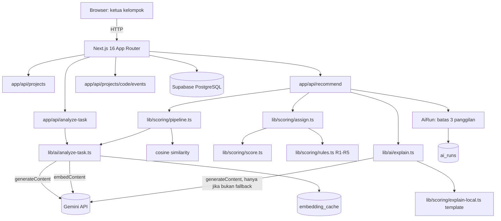
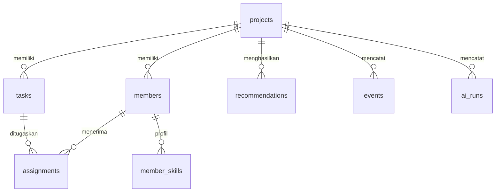

# LAPORAN AKADEMIK
## Pembagi Tugas Kelompok Berbasis Rekomendasi AI

**Sistem:** Teammate AI (AI Group Task Distributor)
**Pendekatan:** Hybrid Simple Recommendation (content-based embedding + weighted scoring + aturan deterministik)
**Stack:** Next.js 16.4.6, TypeScript 5.9.3, Tailwind CSS 4.3.3, Supabase, Gemini API

---

### Identitas Penyusun

| Peran | Nama | NIM |
|---|---|---|
| Penyusun | Anthony Fernando Martono | 25421892 |
| Anggota 1 | Rickel Engsali Putra | 25421946 |
| Anggota 2 | Krisostomus Rendry | 25421932 |
| Anggota 3 | Deluis Reto Bapage | 25421903 |
| Dosen Pengampu | Fredrikus Suarezsaga, S.T., M.T. | - |
| Program Studi | Teknik Informatika | - |
| Institusi | Universitas Widya Dharma Pontianak | - |

### Catatan Format

Tata letak yang diminta (A4, Times New Roman 12 pt, spasi 1,5, margin atas 4 cm, bawah 3 cm, kiri
4 cm, kanan 3 cm, judul bab Heading 1) adalah **persyaratan yang ditetapkan brief Fase 5**, karena
PRD di repository hanya memuat Bagian 1–7 dan tidak memuat Bagian 14 yang dirujuk brief. Persyaratan
itu dicatat sebagai **ASUMSI**, bukan kutipan PRD. Lihat `00_MATRIKS_KETERLACAKAN.md` §2.

Dokumen ini adalah **Markdown**, bukan DOCX, karena repository tidak memiliki mekanisme pembuatan
DOCX (tidak ada pustaka docx, tidak ada skrip konversi). Pengaturan tipografi di atas harus
diterapkan saat dokumen ini dipindahkan ke pengolah kata. Keterbatasan ini dilaporkan, bukan
disembunyikan.

---
---

# BAB 1 PENDAHULUAN

## 1.1 Latar Belakang

Pengerjaan tugas kelompok adalah bagian tetap dari perkuliahan. Satu kelompok biasanya menghadapi
beberapa pekerjaan sekaligus dengan sifat yang berbeda: ada yang butuh penulisan akademik, ada yang
butuh pemrograman, ada yang butuh koordinasi, ada yang butuh presentasi. Anggota kelompok juga tidak
seragam: kemampuan, minat, dan sisa waktunya berbeda.

Pembagian tugas dalam kondisi seperti itu jarang dilakukan dengan perhitungan. Yang lazim terjadi
adalah pembagian berdasarkan kesepakatan cepat, keputusan ketua, atau siapa yang lebih dulu
mengangkat tangan. Cara ini sederhana dan sering selesai dalam beberapa menit, tetapi hasilnya tidak
selalu bisa dipertanggungjawabkan ketika anggota bertanya "mengapa saya yang mengerjakan ini".

Masalah yang muncul punya pola yang berulang. Anggota yang dinilai paling mampu cenderung menerima
lebih banyak pekerjaan, sementara anggota lain masih punya waktu luang. Pekerjaan tertentu jatuh ke
orang yang belum punya keterampilan yang diminta. Dan ketika ada anggota yang berhalangan sehingga
penanggung jawab harus diganti, ketua kelompok harus menghitung ulang dampaknya terhadap beban
semua orang, sesuatu yang hampir tidak mungkin dilakukan secara manual dengan konsisten.

Kondisi inilah yang menjadi motivasi proyek, bukan angka. **Laporan ini tidak memuat statistik
mahasiswa atau data kampus**, karena tidak ada survei atau data institusional yang dikumpulkan
untuk proyek ini. Yang bisa dikatakan dengan jujur adalah: masalah tersebut adalah masalah yang
diakui dalam rumusan PRD, dan proyek ini dibangun untuk mengujinya, bukan untuk mengklaim sudah
mengukurnya.

## 1.2 Identifikasi Masalah

PRD merumuskan empat masalah inti (`prd.md:34-73`). Keempatnya bisa dipetakan langsung ke bagian
sistem yang menanganinya, dan pemetaan inilah yang dipakai sepanjang laporan.

**Tabel 2.1 Pemetaan masalah ke bagian sistem yang menanganinya**

| Masalah | Gejala di lapangan | Ditangani oleh |
|---|---|---|
| Beban kerja tidak seimbang | Satu anggota menerima jauh lebih banyak jam daripada yang lain | Komponen kapasitas (C), aturan R2, pemantauan beban |
| Keterampilan tidak sesuai | Tugas pemrograman jatuh ke anggota tanpa keterampilan itu | Komponen skill (S), aturan R3 |
| Dasar rekomendasi tidak transparan | Anggota tidak tahu mengapa dipilih | Skor K/S/C/M yang terlihat, plus kalimat alasan |
| Sulit mengevaluasi alternatif | Mengganti satu penanggung jawab mengacaukan hitungan manual | Mode what-if dan perbandingan sebelum-sesudah |

Perlu ditegaskan bedanya. **Masalah yang diukur dalam proyek ini** adalah masalah teknis yang bisa
dijumlahkan: berapa pelanggaran aturan, berapa keseragaman beban, berapa cakupan keterampilan.
**Masalah yang menjadi motivasi tetapi tidak diukur** adalah masalah manusia: apakah kelompok menjadi
lebih puas, apakah konflik berkurang, apakah keputusan lebih dipercaya. Aspek manusia itu baru bisa
diukur lewat penilaian reviewer, dan penilaian itu **belum dilakukan** (lihat Bab 3.10).

## 1.3 Rumusan Masalah

1. Bagaimana membangun sistem yang menghasilkan pembagian tugas kelompok dengan dasar perhitungan
   yang bisa diperiksa, bukan sekadar kesepakatan?
2. Seberapa baik pendekatan hybrid (embedding konten + skor berbobot + aturan keras) dibandingkan
   pembagian acak, round-robin, dan pembagian manual pada metrik yang terukur?
3. Apakah komponen kemiripan konten (K) benar-benar mengubah keputusan penugasan, dan apakah
   perubahannya memperbaiki kualitas?
4. Apakah penjelasan yang dihasilkan sistem benar-benar sesuai dengan angka yang dihitung?
5. Apakah integrasi model bahasa (Gemini) berjalan, dan sejauh mana ketergantungan sistem padanya?

## 1.4 Tujuan Proyek

1. Menghasilkan aplikasi web yang membuat proyek kelompok, menerima profil anggota, menerima tugas,
   lalu menghasilkan rekomendasi penugasan beserta rincian skor.
2. Mengukur kinerja pendekatan hybrid terhadap tiga baseline pembanding pada dataset yang dapat
   direproduksi.
3. Mengukur dampak komponen K melalui ablasi terkontrol.
4. Mengukur kejujuran penjelasan secara kuantitatif, bukan berdasarkan kesan.
5. Memverifikasi integrasi Gemini secara langsung ke provider, dan melaporkan apa adanya bila ada
   bagian yang belum terbukti.

## 1.5 Manfaat Proyek

Bagi kelompok mahasiswa, sistem memberi usulan penugasan yang disertai alasan dan angka, sehingga
perdebatan bisa berpindah dari "siapa yang mau" ke "angka mana yang lebih masuk akal".

Bagi ketua kelompok, perubahan penanggung jawab bisa diuji lebih dulu tanpa mengubah data, sehingga
keputusan tidak diambil dengan menebak.

Bagi pengembangan keilmuan, proyek ini menyediakan satu studi kasus yang jujur: hasilnya sebagian
mendukung pendekatan hybrid, sebagian tidak, dan bagian yang tidak mendukung dilaporkan dengan angka.
Itu lebih berguna daripada klaim keberhasilan tanpa pembanding.

## 1.6 Batasan Masalah

1. Cakupan adalah MVP sebagaimana dibatasi PRD Bagian 7. Tidak ada sistem login; akses memakai kode
   proyek.
2. Keputusan penugasan ditentukan mesin skor dan aturan, **bukan** model bahasa. Gemini dipakai untuk
   analisis teks, embedding, dan penjelasan.
3. Evaluasi memakai dataset sintetis (D1, D2). Tidak ada data kelompok nyata (D3) karena tidak ada
   persetujuan yang diperoleh.
4. Penilaian manusia (human agreement) tidak dilakukan karena tidak tersedia tiga reviewer.
5. Model bahasa diakses lewat kuota gratis, yang membatasi jumlah pengujian live per hari.
6. Format laporan mengikuti brief Fase 5, karena PRD di repository berhenti di Bagian 7.

---
---

# BAB 2 LANDASAN TEORI DAN PERANCANGAN

## 2.1 Sistem Rekomendasi dan Pendekatan Simple Recommendation

Sistem rekomendasi pada dasarnya memetakan informasi tentang pengguna dan item menjadi saran.
Tinjauan Lops dkk. (2011) membagi pendekatan besar menjadi content-based, collaborative, dan hybrid.
Pazzani dan Billsus (2007) merinci content-based sebagai pendekatan yang membangun profil pengguna
dari atribut item yang pernah disukai, lalu mencocokkannya dengan atribut item baru.

Sistem ini **tidak** memakai collaborative filtering. Alasannya bukan karena collaborative buruk,
tetapi karena syarat datanya tidak terpenuhi. Collaborative filtering, termasuk bentuk modernnya
berupa matrix factorization (Koren dkk., 2009), membutuhkan riwayat interaksi banyak pengguna
terhadap banyak item untuk menemukan pola kesamaan. Pada aplikasi ini, setiap proyek adalah ruang
terpisah dengan 2–6 anggota, dan tidak ada riwayat lintas proyek yang bisa dipakai. Dengan data
sesedikit itu, collaborative filtering tidak punya dasar untuk bekerja.

Burke (2002) menunjukkan bahwa penggabungan beberapa pendekatan (hybrid) sering lebih tahan
terhadap kelemahan masing-masing komponen. Itu yang dipakai di sini: content-based untuk kemiripan
teks, skor berbobot untuk menggabungkan beberapa kriteria, dan aturan keras untuk menjaga batasan
yang tidak boleh dilanggar.

**Keputusan desain, dua sudut pandang:**

- *Teknis:* content-based bisa bekerja dengan data satu proyek saja, tidak butuh riwayat lintas
  pengguna, dan hasilnya bisa dijelaskan per komponen.
- *Produk:* kelompok mahasiswa butuh alasan yang bisa dibaca ("kamu dipilih karena menguasai
  penulisan akademik dan masih punya 90% kapasitas"), bukan rekomendasi kotak hitam.

## 2.2 Content-Based Filtering

Content-based filtering mencocokkan atribut item dengan profil pengguna (Pazzani & Billsus, 2007;
Lops dkk., 2011). Pada sistem ini "item" adalah tugas dan "pengguna" adalah anggota kelompok.

Pencocokan dilakukan lewat dua jalur yang sengaja dipisah:

1. **Jalur eksplisit**: skill wajib tugas dibandingkan dengan level skill anggota. Ini yang
   menghasilkan komponen S, dan inilah yang dipakai aturan R3.
2. **Jalur semantik**: teks tugas dan teks profil anggota diubah menjadi vektor, lalu dibandingkan
   dengan cosine similarity. Ini yang menghasilkan komponen K.

Pemisahan ini penting untuk kejujuran pengukuran. Kalau keduanya dicampur, tidak mungkin diketahui
apakah kualitas penugasan datang dari pencocokan skill yang eksplisit atau dari kemiripan semantik.
Dengan dipisah, ablasi di Bab 3.5 bisa mematikan K sendirian dan melihat akibatnya.

## 2.3 Text Embedding

Embedding adalah representasi teks sebagai vektor bilangan real, sehingga kedekatan makna bisa
diukur sebagai kedekatan geometris. Mikolov dkk. (2013) menunjukkan bahwa vektor kata yang dilatih
pada korpus besar menangkap hubungan semantik yang berguna. Perkembangan berikutnya memindahkan ide
yang sama ke tingkat kalimat dan paragraf; Reimers dan Gurevych (2019) menunjukkan bahwa embedding
kalimat bisa dipakai langsung dengan cosine similarity untuk mencari kemiripan makna.

Pada sistem ini, embedding dibuat oleh Gemini melalui `embedContent` dengan
`outputDimensionality: 768`. Angka 768 bukan pilihan bebas: kolom database tempat hasilnya disimpan
bertipe `vector(768)` (`supabase/migrations/001_initial_schema.sql:36`), dan kode menolak vektor
dengan panjang selain 768 (`lib/ai/embedding-cache.ts:5,11-17`). Vektor yang panjangnya berbeda tidak
bisa disimpan maupun dibandingkan, jadi konsistensi dimensi adalah syarat, bukan preferensi.

**Keputusan desain, dua sudut pandang:**

- *Teknis:* embedding menangkap kesamaan makna yang tidak tertangkap daftar skill terbatas. Dua tugas
  yang berbeda judulnya tetapi sama intinya bisa dikenali mirip.
- *Produk:* deskripsi tugas ditulis bebas oleh pengguna. Memaksa pengguna memilih dari taksonomi
  tertutup akan mengurangi kegunaan aplikasi.

Hasil embedding disimpan di cache (`embedding_cache`) supaya pemanggilan berulang tidak memakan
kuota. Ini bukan optimasi opsional: dengan kuota gratis 20 permintaan per hari per model, cache
adalah yang membuat aplikasi bisa dipakai lebih dari beberapa kali sehari.

## 2.4 Cosine Similarity

Cosine similarity mengukur kosinus sudut antara dua vektor. Dasar formalnya adalah model ruang
vektor untuk pengindeksan otomatis (Salton dkk., 1975), yang merepresentasikan dokumen sebagai vektor
dan mengukur kedekatan lewat sudut antarvektor. Nilainya berkisar dari -1 sampai 1, dan pada
praktiknya untuk embedding teks hampir selalu berada di rentang 0 sampai 1.

Rumusnya:

```
cos(a, b) = (a · b) / (||a|| × ||b||)
```

Sistem tidak memakai nilai mentah itu langsung pada skor. Nilai mentah dipetakan lebih dulu ke
rentang 0–1 dengan batas bawah 0,2 dan batas atas 0,8 (`lib/scoring/constants.ts:24-25`,
`lib/scoring/score.ts:5-9`):

```
K = 0                                   jika cos ≤ 0,2
K = (cos − 0,2) / (0,8 − 0,2)           jika 0,2 < cos < 0,8
K = 1                                   jika cos ≥ 0,8
```

**Alasan pemetaan ini, dua sudut pandang:**

- *Teknis:* cosine antara dua teks berbahasa alami jarang turun mendekati 0 dan jarang mendekati 1.
  Tanpa pemetaan, komponen K hanya akan memakai sebagian kecil rentangnya, sehingga bobotnya secara
  efektif lebih kecil daripada angka bobot yang tertulis. Pemetaan membuat 0,2–0,8 terpakai penuh.
- *Produk:* pengguna melihat angka K antara 0 dan 1. Angka yang selalu berkisar 0,55–0,65 akan sulit
  ditafsirkan dan sulit dibandingkan antaranggotа.

## 2.5 Weighted Scoring dan Penilaian Multikriteria

Penilaian multikriteria menggabungkan beberapa kriteria yang tidak sebanding menjadi satu nilai
keputusan. Saaty (1990) menjelaskan bahwa inti persoalan pada penilaian semacam ini adalah
menetapkan bobot antar-kriteria secara sadar, bukan membiarkannya tersembunyi.

Sistem memakai empat komponen. Semuanya dinormalisasi ke rentang 0–1 sebelum digabungkan
(`lib/scoring/score.ts:11-46`):

**Tabel 2.2 Empat komponen skor dan rumusnya**

| Komponen | Nama | Rumus |
|---|---|---|
| K | Kemiripan konten | cosine similarity yang dipetakan (§2.4) |
| S | Kesesuaian skill | rata-rata level skill wajib ÷ 5; bernilai 1 bila tugas tidak butuh skill |
| C | Kapasitas | (kapasitas − beban − jam tugas) ÷ kapasitas; 0 bila negatif atau kapasitas 0 |
| M | Minat | (rata-rata level minat − 1) ÷ 4; bernilai 1 bila tugas tidak butuh skill |

Skor total adalah jumlah berbobot:

```
total = (w_K × K) + (w_S × S) + (w_C × C) + (w_M × M)
```

Bobot default (`lib/scoring/constants.ts:5-10`):

**Tabel 2.3 Bobot default dan bobot mode cadangan**

| Komponen | Bobot default | Bobot mode cadangan |
|---|---|---|
| K | 0,40 | 0,00 |
| S | 0,30 | 0,50 |
| C | 0,20 | 0,33 |
| M | 0,10 | 0,17 |

**Keputusan desain, dua sudut pandang:**

- *Teknis:* bobot eksplisit membuat kontribusi setiap komponen bisa dihitung ulang oleh pengguna.
  Ini juga yang membuat slider bobot bermakna: mengubah bobot benar-benar mengubah skor.
- *Produk:* kelompok yang lebih mementingkan kesesuaian skill daripada kemiripan teks bisa
  menggeser bobot sendiri, dan melihat akibatnya segera.

Catatan kejujuran: bobot 0,40/0,30/0,20/0,10 adalah **keputusan desain awal**, bukan hasil optimasi.
Laporan ini tidak mengklaim bobot tersebut optimal. Tidak ada pencarian bobot (grid search) yang
dilakukan.

## 2.6 Constraint-Based Assignment

Di atas skor, ada batasan yang tidak boleh dilanggar apa pun hasil skornya. Ini memindahkan sebagian
persoalan ke wilayah constraint satisfaction (Tsang, 1993) dan masalah penugasan (Kuhn, 1955).

Lima aturan yang berlaku, dibaca langsung dari kode:

**Tabel 2.4 Definisi aturan keras R1–R5 yang berlaku di kode**

| Aturan | Definisi yang berlaku | Lokasi |
|---|---|---|
| R1 | Anggota dengan kapasitas 0 bukan kandidat | `lib/scoring/rules.ts:4` |
| R2 | Beban setelah menerima tugas ≤ 1,25 × beban ideal **dan** ≤ kapasitas | `lib/scoring/rules.ts:8-12` |
| R3 | Kandidat adalah anggota dengan ≥ 1 skill wajib level ≥ 3; bila tidak ada, semua anggota menjadi kandidat | `lib/scoring/rules.ts:14` |
| R4 | Setiap tugas punya tepat satu penanggung jawab | ditegakkan struktural di `lib/scoring/assign.ts` |
| R5 | Tugas terkunci mempertahankan pemiliknya | `lib/scoring/assign.ts:41-56` |

Dua hal penting yang perlu dikatakan terbuka.

Pertama, **R4 dan R5 tidak dipanggil sebagai fungsi pemeriksa**. Keduanya ditegakkan oleh struktur
data: satu `primaryMemberId` per tugas, dan peta tugas terkunci. Ini bukan kelalaian, tetapi
konsekuensinya adalah R4 dan R5 tidak bisa "gagal" dalam arti yang sama seperti R1–R3; keduanya
selalu terpenuhi secara struktural. Laporan evaluasi mencatat hal ini (`eval/reports/D_HARD_RULES.md`).

Kedua, **R2 menggabungkan dua syarat**. Kegagalan R2 karena itu tidak bisa dipisahkan dari "kapasitas
habis". Ini memengaruhi cara membaca angka pelanggaran R2 di Bab 3.

Sistem memakai heuristik greedy, bukan solver optimal seperti metode Hungarian (Kuhn, 1955).

**Alasan tidak memakai solver optimal, dua sudut pandang:**

- *Teknis:* solver optimal memaksimalkan jumlah skor, tetapi tidak otomatis menghormati aturan keras
  seperti R5 (kunci) dan R3 (kandidat). Menambahkan semua itu sebagai batasan akan menghasilkan
  masalah yang jauh lebih rumit, sementara jumlah tugas dan anggota pada satu proyek kecil.
  Pengukuran menunjukkan komputasi seluruh pipeline untuk 20 skenario berada di bawah 1 ms pada P95
  (`eval/results/performance.json`), jadi kerumitan tambahan tidak sepadan.
- *Produk:* pengguna perlu melihat alasan per tugas. Heuristik greedy menghasilkan jejak keputusan
  per tugas yang mudah dijelaskan; solusi optimal gabungan lebih sulit diterjemahkan menjadi kalimat
  alasan yang bisa dibaca.

Keterbatasan pendekatan ini diakui: greedy tidak menjamin hasil terbaik secara global. Bab 3.4
menunjukkan akibatnya secara terukur.

## 2.7 Generative AI dan Gemini API

Model bahasa besar dipakai pada tiga titik, dengan batas yang tegas: **tidak** dipakai untuk
menentukan siapa mengerjakan apa.

**Tabel 2.5 Tiga titik pemakaian model bahasa dan batasnya**

| Titik | Fungsi | Batas |
|---|---|---|
| Analisis tugas | Mengusulkan skill, tingkat kesulitan, estimasi jam dari deskripsi bebas | Pengguna memeriksa dan mengoreksi sebelum diterapkan |
| Embedding | Mengubah teks tugas dan profil menjadi vektor 768 dimensi | Hanya menghasilkan angka, tidak memilih |
| Penjelasan | Menyusun kalimat alasan untuk penugasan yang sudah ditetapkan mesin | Hanya menjelaskan; skor dan pemilik sudah final |

Keluarga model Gemini dijelaskan dalam laporan teknis Gemini Team (2024). Perlu dicatat bahwa
laporan itu adalah **preprint**, bukan artikel jurnal peer-reviewed, dan laporan ini menyebutnya apa
adanya.

Kerangka penjelasan yang dipakai mengacu pada Gunning dan Aha (2019) tentang sistem AI yang bisa
menjelaskan alasannya, dan Miller (2019) yang menekankan bahwa penjelasan yang berguna bagi manusia
bukan sekadar membuka bobot model, melainkan memilih alasan yang relevan dan kontras dengan
alternatif.

**Keputusan desain, dua sudut pandang:**

- *Teknis:* memisahkan penentuan dari penjelasan membuat skor tetap dapat direproduksi meskipun
  model bahasa berubah atau gagal. Penjelasan boleh berbeda kata; angka tidak boleh berbeda.
- *Produk:* pengguna bisa mematikan AI dan tetap mendapat rekomendasi yang lengkap, hanya tanpa
  kalimat yang dihasilkan model. Ini yang membuat aplikasi tetap berguna saat kuota habis.

### Batas tiga panggilan

PRD menetapkan maksimal tiga panggilan Gemini per proses. Batas ini ditegakkan di kode
(`lib/ai/call-budget.ts:14`), dengan slot dipesan **sebelum** panggilan dilakukan, sehingga panggilan
gagal pun tetap memakai slot (`.79-96`). Cache hit tidak dihitung, karena entri cache dilewati
sebelum panggilan direncanakan (`lib/ai/analyze-task.ts:117-127`).

**Keputusan desain, dua sudut pandang:**

- *Teknis:* satu panggilan embedding yang dibatch menangani semua teks sekaligus, sehingga kebutuhan
  khas adalah satu panggilan embedding dan satu panggilan penjelasan.
- *Produk:* biaya dan kuota tetap dapat diprediksi. Pengguna tidak bisa tanpa sengaja menghabiskan
  kuota karena satu klik berulang.

## 2.8 Arsitektur Sistem



Alurnya sengaja satu arah. Permintaan rekomendasi tidak pernah mengubah data penugasan; ia
mengembalikan usulan. Penyimpanan keputusan terjadi hanya ketika pengguna menerima atau mengubah
penugasan secara eksplisit.

**Keputusan desain, dua sudut pandang:**

- *Teknis:* memisahkan perhitungan (usulan) dari penyimpanan (keputusan) membuat permintaan
  rekomendasi bisa diulang kapan saja tanpa mengotori data.
- *Produk:* pengguna bisa mencoba berkali-kali dengan bobot berbeda tanpa takut merusak pembagian
  yang sudah disepakati.

## 2.9 Perancangan Basis Data

Skema dibuat lewat migrasi SQL bertahap. Tabel inti:

**Tabel 2.6 Tabel inti basis data dan sumber migrasinya**

| Tabel | Isi | Sumber |
|---|---|---|
| `projects` | Proyek, kode akses, tenggat | `001_initial_schema.sql:7` |
| `members` | Anggota, kapasitas, skill, preferensi | `001_initial_schema.sql:16` |
| `tasks` | Tugas, jam, skill wajib, embedding | `001_initial_schema.sql:28` |
| `recommendations` | Rekomendasi tersimpan | `001_initial_schema.sql:41` |
| `assignments` | Penugasan final, status kunci | `001_initial_schema.sql:52` |
| `events` | Jejak aksi pengguna (FR-16) | `001_initial_schema.sql:62` |
| `embedding_cache` | Cache vektor 768 dimensi | `001_initial_schema.sql:71` |
| `ai_runs` | Catatan satu proses AI (NFR-43/44) | `001_initial_schema.sql:79` |
| `member_skills` | Skill terstruktur per anggota (FR-03) | `003_member_profile_fr03.sql:11` |

Relasi utamanya:



**Keputusan desain, dua sudut pandang:**

- *Teknis:* `embedding_cache` dipisah dari `tasks` supaya cache bisa dipakai bersama oleh teks tugas
  maupun teks anggota, dan supaya membuang cache tidak menyentuh data tugas.
- *Produk:* semua data satu proyek bisa dihapus dengan satu operasi (`on delete cascade`), sehingga
  tidak meninggalkan sisa data.

Satu catatan keterbatasan yang perlu disebut: tabel `ai_runs` **tidak punya kolom untuk pesan error
maupun jumlah panggilan** (`lib/ai/ai-run.ts:7-17`). Akibatnya kegagalan AI tercatat sebagai status,
tanpa alasan. Kekurangan ini ditemukan saat audit Fase 2 dan dilaporkan di sana, bukan diperbaiki
pada fase dokumentasi ini.

## 2.10 Dataset yang Digunakan

### D1: Tugas template dan tugas non-IT

11 tugas template bawaan aplikasi (`lib/constants/task-templates.ts`, terbukti `id: 'T01'..'T11'`)
ditambah 15 variasi tugas non-IT, seluruhnya 26 tugas.

**Tabel 2.7 Karakteristik dataset D1**

| Aspek | Sebaran |
|---|---|
| Total | 26 |
| Template | 11 |
| Non-IT | 15 |
| Domain | 11 domain (proyek AI, makalah akademik, presentasi, analisis bisnis, desain publikasi, dan lain-lain) |
| Panjang deskripsi | 7 pendek, 12 sedang, 7 panjang |
| Tingkat usaha | 6 rendah, 15 sedang, 5 tinggi |
| Jumlah skill | 4 tunggal, 22 majemuk, 0 tanpa skill |
| Skill berbeda | 10 |

Sumber: `eval/results/dataset_summary.json`, `eval/datasets/d1_tasks.ts`.

Tujuan D1 adalah memastikan sistem tidak hanya bekerja untuk tugas pemrograman, karena kelompok
mahasiswa non-IT juga butuh alat ini.

### D2: Skenario kelompok sintetis

20 skenario yang dirancang menutup 15 kondisi berbeda, dengan total 49 anggota dan 35 tugas.

Kondisi yang dicakup: beban awal tak seimbang, jam tersedia nol, kapasitas rendah, kapasitas tinggi,
minat berbeda, satu anggota sangat tinggi, semua di bawah level 3, skill merata, skill tidak cocok,
skill wajib beragam, skill dan minat tinggi dengan kapasitas rendah, tidak ada kandidat R2, tugas
bersaing, tugas terkunci, dan tugas usaha tinggi.

Sumber: `eval/results/dataset_summary.json`, `eval/datasets/d2_scenarios.ts`.

**Ini data sintetis, bukan data pengguna nyata.** Seluruh laporan menyebutnya demikian. Skenario
dibuat untuk menekan kondisi sulit yang jarang muncul pada data kecil, bukan untuk meniru populasi
mahasiswa tertentu.

### D3: Data kelompok nyata

**Tidak ditemukan.** Tidak ada berkas D3 di `eval/datasets/`, dan tidak ada bukti persetujuan
pengumpulan data dari kelompok nyata. Karena itu D3 tidak dipakai, dan tidak ada satu pun klaim
dalam laporan ini yang bersandar pada data nyata.

## 2.11 Implementasi Sistem

### Analisis tugas

`analyzeTasksWithGemini` (`lib/ai/analyze-task.ts:22-54`) mengirim daftar tugas ke
`generateContent` dan meminta keluaran JSON yang divalidasi skema. Hasilnya tidak langsung
diterapkan: pengguna memeriksa dan mengoreksi lebih dulu di antarmuka.

Perlindungan prompt injection bersifat struktural: teks tugas diperlakukan sebagai data, dan
instruksi yang tertanam di dalamnya diabaikan oleh prompt. Konsekuensi yang lebih kuat adalah
bahwa deskripsi tugas **tidak dipakai** untuk memilih pemilik, sehingga injeksi tidak bisa
memindahkan penugasan. Ini diuji sebagai kondisi 7 di `eval/results/robustness.json`.

### Embedding dan cache

`embedTexts` (`lib/ai/analyze-task.ts:108+`) bekerja begini: untuk setiap teks, cek cache lebih dulu;
yang ada di cache dilewati; sisanya dibatch menjadi satu panggilan `embedContent`. Hasil yang
kembali divalidasi 768 dimensi sebelum disimpan. Kegagalan pada tahap ini mengembalikan nilai kosong,
bukan melempar error.

### Perhitungan cosine similarity

`computeTaskMemberCosineMap` (`lib/scoring/pipeline.ts`) membentuk teks tugas dan teks anggota,
mengambil vektor keduanya, lalu menghitung cosine untuk setiap pasangan tugas–anggota. Hasil inilah
yang tampil sebagai bagian `cosineMap` pada respons API.

### Komponen S, C, M dan skor hybrid

Rumusnya di §2.5, implementasinya `lib/scoring/score.ts:11-78`. Perlu dicatat satu perilaku yang
mudah disalahpahami: bila anggota melanggar R1 atau R2, **skor totalnya dipaksa menjadi 0**, tetapi
komponen K/S/C/M tetap dilaporkan apa adanya. Jadi tabel bisa menampilkan C = 0,875 dengan total 0.
Ini disengaja, supaya pengguna bisa melihat komponen yang sebenarnya sambil tahu bahwa anggota
tersebut gugur.

### Aturan R1–R5

Sudah dibahas di §2.6. Evaluasinya ada di Bab 3.3.

### Penugasan global

`globalAssign` (`lib/scoring/assign.ts`) memproses tugas satu per satu. Beban ideal dihitung sebagai
total jam dibagi jumlah anggota. Untuk setiap tugas, kandidat disaring R3, diberi skor, lalu dipilih
yang tertinggi dengan tetap menghormati R1, R2, dan R5.

Satu perilaku yang perlu diketahui pembaca: ketika tidak ada kandidat yang memenuhi R2, sistem tetap
menugaskan kandidat terbaik dan **melanggar R2** alih-alih meninggalkan tugas tanpa pemilik. Ini
keputusan produk yang terbuka, bukan penyelesaian sempurna (`eval/reports/D_HARD_RULES.md`).

### Penjelasan rekomendasi

Ada dua jalur. Jalur template (`lib/scoring/explain-local.ts`) menyusun kalimat dari angka yang
sudah dihitung, selalu tersedia, dan tidak butuh jaringan. Jalur model (`lib/ai/explain.ts`) meminta
kalimat dari Gemini, dengan validator yang menolak kalimat yang menyebut anggota lain atau angka yang
tidak sesuai.

### Mode fallback

Aktif bila tidak ada embedding yang berhasil diperoleh. K dipaksa 0, bobot berpindah ke S/C/M, dan
antarmuka menampilkan pemberitahuan tetap bahwa mode cadangan aktif
(`app/p/[code]/result/result-client.tsx:793-804`).

### Batas tiga panggilan

Sudah dijelaskan di §2.7.

### Interaksi pengguna

Slider bobot menghitung ulang di browser tanpa memanggil server. Mode what-if menampilkan pratinjau
perubahan sebelum diterapkan. Kunci menjaga tugas tetap pada pemiliknya. Undo membatalkan satu
langkah terakhir. Ekspor menghasilkan CSV dan teks tanpa memanggil Gemini.

## 2.12 Teknologi dan Alasan Pemilihan

Versi di bawah **dibaca dari `package.json` dan `node_modules`**, bukan dari ingatan. Satu koreksi
penting terhadap brief: **Playwright tidak terpasang** sebagai dependensi. Pengukuran browser pada
Fase 4 memakai Chromium headless lewat protokol CDP, bukan paket `@playwright/test`. Klaim "Playwright"
karena itu tidak dipakai di laporan ini.

**Tabel 2.8 Teknologi, versi terpasang, dan alasan pemilihan**

| Teknologi | Versi terpasang | Alasan teknis | Alasan produk |
|---|---|---|---|
| Next.js | 16.4.6 | App Router menyatukan server dan klien; API route menghindari server terpisah | Satu proses untuk dijalankan saat demo |
| TypeScript | 5.9.3 | Tipe memaksa kontrak data antar modul AI, skor, dan UI | Kesalahan data tertangkap saat pengembangan, bukan saat presentasi |
| Tailwind CSS | 4.3.3 | Utilitas CSS langsung di komponen | Tampilan konsisten tanpa file CSS besar |
| Supabase | `@supabase/supabase-js` 2.119.0 | Postgres siap pakai dengan dukungan `pgvector` | Tidak perlu menyiapkan server basis data sendiri |
| Gemini API | `@google/genai` 3.3.0 | Menyediakan `generateContent` dan `embedContent` dalam satu SDK | Biaya rendah; ada kuota gratis untuk pengembangan |
| Zod | 4.6.7 | Validasi keluaran model sebelum dipakai | Keluaran model yang tidak sesuai skema tidak merusak data |
| Vitest | 5.1.0 | Pengujian cepat, satu alat untuk unit dan eval | Hasil uji bisa ditunjukkan langsung saat presentasi |
| GitHub | - | Kendali versi | Riwayat kerja tim |
| Vercel | - | Penerapan Next.js langsung | **Tidak dipakai**; `docs/STATUS.md` tidak mencatat penerapan |
| OpenCode | - | Lingkungan agen pengembangan | Alat kerja, bukan bagian produk |

**Catatan koreksi:** brief menyebut Playwright, GitHub, Vercel, dan OpenCode sebagai teknologi.
Dari keempatnya, hanya GitHub dan OpenCode yang punya jejak di repository. Playwright tidak
terpasang. Vercel tidak terbukti dipakai. Keduanya dicatat sebagai ketidaksesuaian, bukan ditulis
seolah terpakai.
